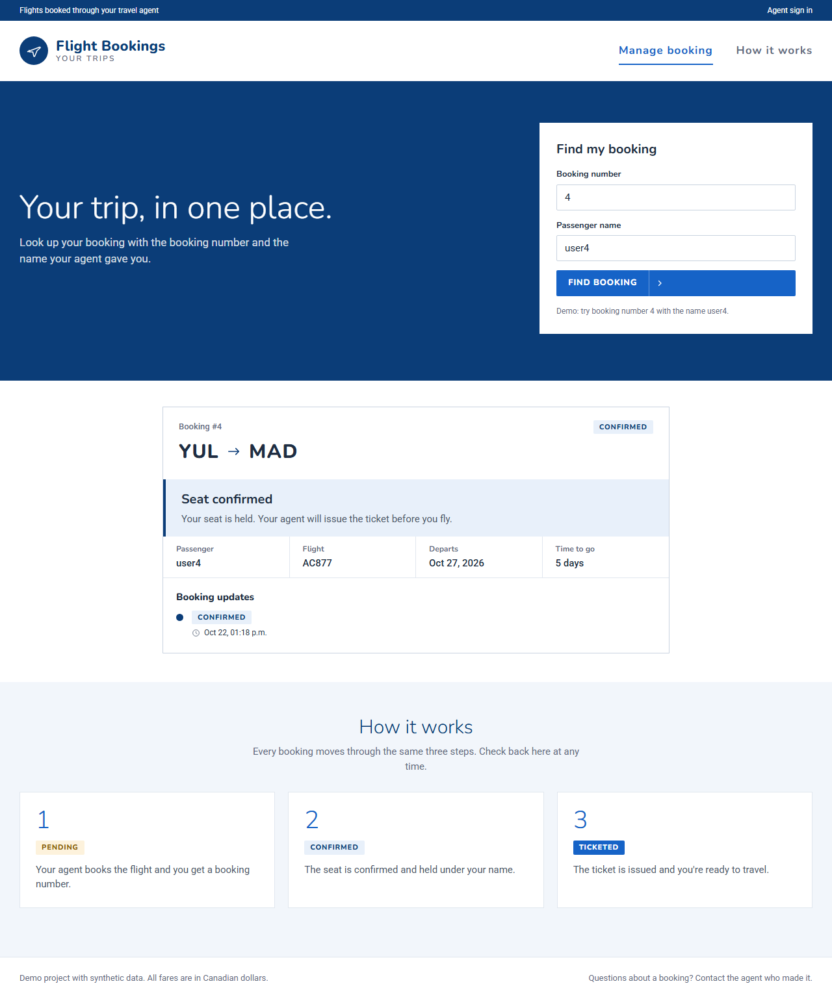
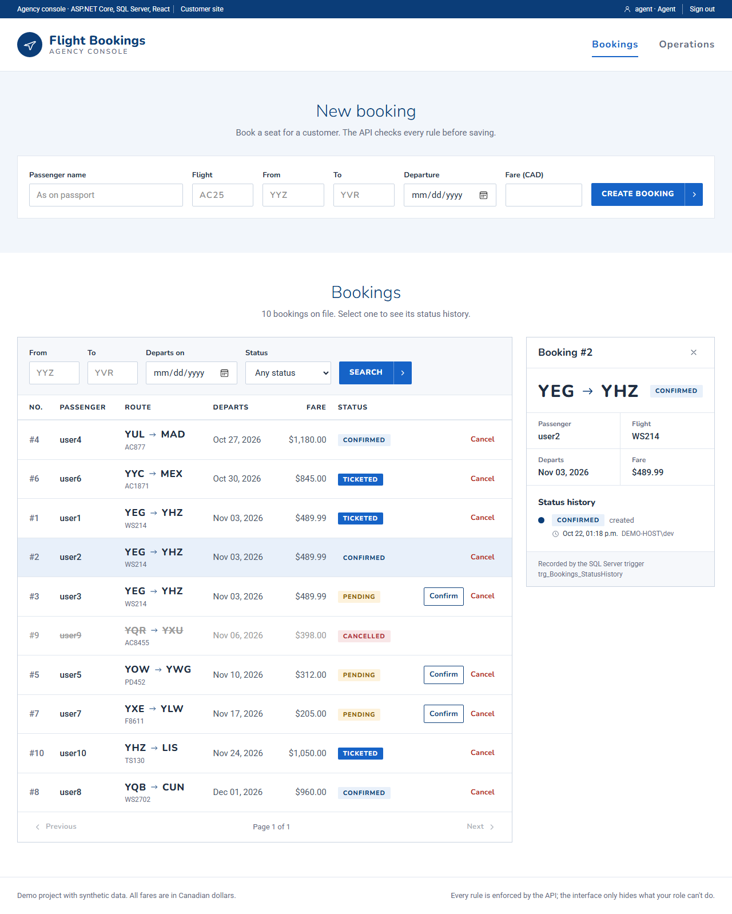
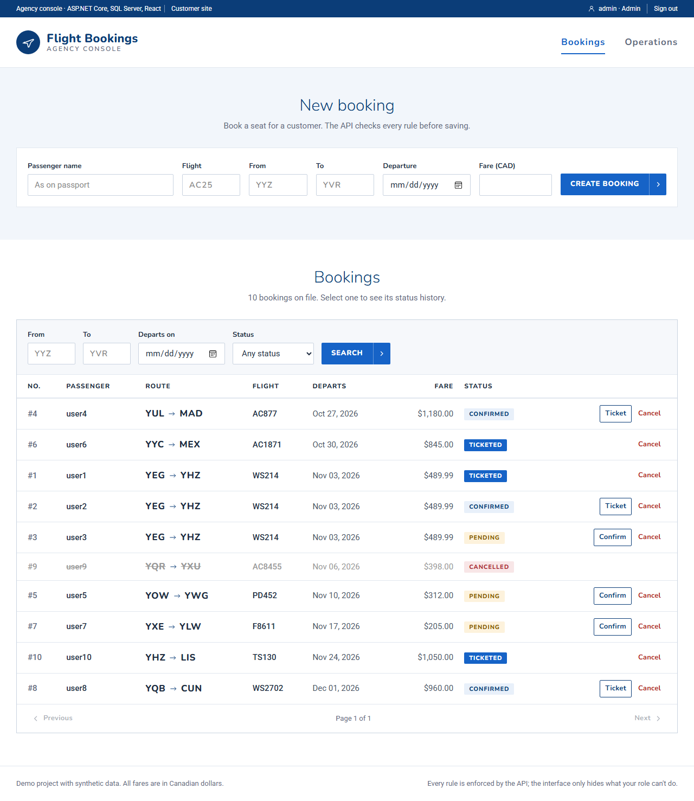
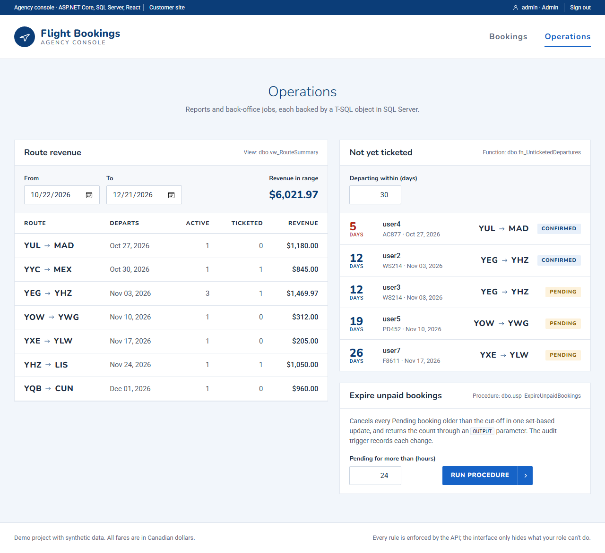
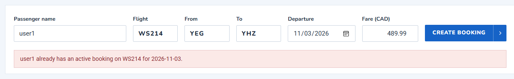
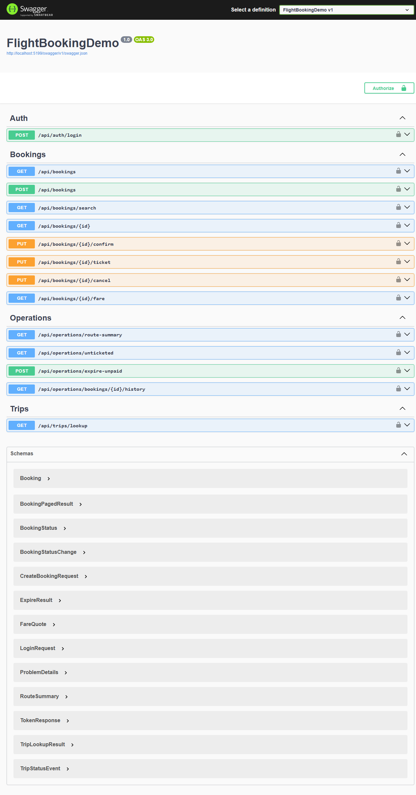

# FlightBookingDemo

A small flight-booking REST API in **ASP.NET Core 8**, **Entity Framework Core** and **SQL Server**. It models the airline flow (book, confirm, ticket, cancel), enforces booking rules in the service layer and the database, converts fares through a live third-party exchange-rate API with timeouts, retries and caching, and protects endpoints with JWT bearer auth and roles.

## Endpoints

| Method | Route | Auth | Notes |
|---|---|---|---|
| POST | `/api/auth/login` | none | Returns a JWT (`accessToken`, `expiresAtUtc`) |
| GET | `/api/bookings` | any user | All bookings |
| GET | `/api/bookings/{id}` | any user | 404 if missing |
| GET | `/api/bookings/search?origin=&destination=&date=&status=&page=&pageSize=` | any user | Optional filters, paged (max 100 per page) |
| POST | `/api/bookings` | any user | 201 + `Location`; 400 on invalid input; 409 on duplicate active booking |
| PUT | `/api/bookings/{id}/confirm` | any user | Pending to Confirmed |
| PUT | `/api/bookings/{id}/ticket` | **Admin** | Confirmed to Ticketed; 403 for agents |
| PUT | `/api/bookings/{id}/cancel` | any user | Any active status to Cancelled |
| GET | `/api/bookings/{id}/fare?currency=USD` | any user | Live conversion; 503 + `Retry-After` if the rates API is down |
| GET | `/api/operations/route-summary?from=&to=` | any user | Route revenue report from the view `vw_RouteSummary` |
| GET | `/api/operations/unticketed?days=30` | any user | Bookings still needing a ticket, from the function `fn_UnticketedDepartures` |
| POST | `/api/operations/expire-unpaid?olderThanHours=24` | **Admin** | Runs the stored procedure `usp_ExpireUnpaidBookings` |
| GET | `/api/operations/bookings/{id}/history` | any user | Status history written by the trigger `trg_Bookings_StatusHistory` |
| GET | `/api/trips/lookup?reference=&name=` | anonymous, 10/min per IP | Passenger self-service: booking summary plus status history; one 404 for any mismatch; 429 + `Retry-After` over the limit |

Errors use the standard `ProblemDetails` JSON format (RFC 9110).

## Screenshots

Customer site: a traveller looks up their own booking with the booking number and name. The lookup endpoint is anonymous, rate limited, and gives the same answer for a wrong number or a wrong name:



Agent view, with a booking's status history (written by the SQL Server trigger) open on the right. Fares are shown in CAD; the live conversion endpoint is in Swagger:



Admins also see **ticket** on Confirmed bookings (the API enforces the same rule with a 403 for agents):



Operations, where each report names the T-SQL object behind it (a view, a table-valued function and an admin-only stored procedure):



A duplicate active booking is rejected with the API's 409 message:



Every endpoint in Swagger:



## Run it

Requirements: .NET 8 SDK, SQL Server LocalDB (included with Visual Studio, or SQL Server Express LocalDB) and Node 20+.

### One command (Windows)

```powershell
.\start-demo.ps1
```

The script checks the prerequisites, starts LocalDB, and on first run creates `appsettings.Local.json` with a random JWT signing key and two demo users (`agent` and `admin`), then prints their passwords. It opens the API and the client in their own windows and launches the app and Swagger in the browser. In Development the database is created from the migrations and filled with 10 sample bookings on startup.

### Manually

Copy `appsettings.Local.example.json` to `appsettings.Local.json` and fill in a signing key of at least 32 characters and the demo passwords. The file is gitignored. Then:

```bash
dotnet tool restore
dotnet watch
```

Open http://localhost:5130/swagger, call `POST /api/auth/login`, click **Authorize**, and paste the token.

The React + TypeScript frontend lives in `client/`:

```bash
cd client
npm install
npm run dev
```

Open http://localhost:5173 for the customer site and http://localhost:5173/agent for the agency console. It calls the API at `http://localhost:5130` (override with `VITE_API_URL` in `client/.env.development.local`). The API allows this origin through the `Cors:AllowedOrigins` setting.

## Design choices

- **Layers:** thin controllers (HTTP only), a service behind `IBookingService` (business rules), EF Core `DbContext` (data). Services are injected with ASP.NET Core DI; the service and `DbContext` are scoped per request.
- **Entities vs DTOs:** requests bind to records (`CreateBookingRequest`), so clients can't over-post `Id`, `Status` or `CreatedAt`.
- **Schema:** configured with the fluent API: `decimal(18,2)` for money, `nchar(3)` IATA codes, status stored as a string for readable SQL and reports. Managed with EF Core migrations.
- **Rules in layers:** data annotations (400), service rules and a status state machine (400/409), and a **filtered unique index** in SQL Server that guarantees one active booking per passenger, flight and date even under concurrent requests.
- **Search:** `IQueryable` composed from optional filters into one parameterized query; stable ordering for paging; a composite index on `(Origin, Destination, DepartureDate)`, verified with execution plans.
- **Third-party integration:** typed `HttpClient` via `IHttpClientFactory`, 5-second timeout, retries with exponential backoff on transient failures only (network, timeout, 5xx, 429), 10-minute `IMemoryCache`, supplier DTOs kept separate from domain types, and a 503 with `Retry-After` when the supplier is down. Retries are only safe because the call is an idempotent GET; booking or payment calls would need an idempotency key. In production, `Microsoft.Extensions.Http.Resilience` (Polly) would replace the hand-written retry loop and add a circuit breaker.
- **T-SQL objects:** a view, an inline table-valued function, a stored procedure with an OUTPUT parameter, and an audit trigger, deployed through a hand-written EF Core migration and called from C# with LINQ over the view, `FromSql`, and `ExecuteSqlRaw` with `SqlParameter`.
- **Auth:** JWT bearer tokens validated for signature, issuer, audience and lifetime; `[Authorize]` by default, `[Authorize(Roles = "Admin")]` on ticketing. Demo passwords are hashed with `PasswordHasher`. The signing key and demo users live in the gitignored `appsettings.Local.json`, and the API refuses to start without a key of at least 32 characters.

## Project layout

```text
Auth/          JWT options, token service, demo user store
Controllers/   AuthController, BookingsController, OperationsController
Data/          AppDbContext (schema configuration), DemoDataSeeder
Migrations/    EF Core migrations
Models/        Booking entity, request/response records
Services/      IBookingService, EfBookingService, OperationsService, ExchangeRateClient, ServiceResult
client/        React + TypeScript frontend (Vite)
docs/          README screenshots
start-demo.ps1 one-command local demo
```
